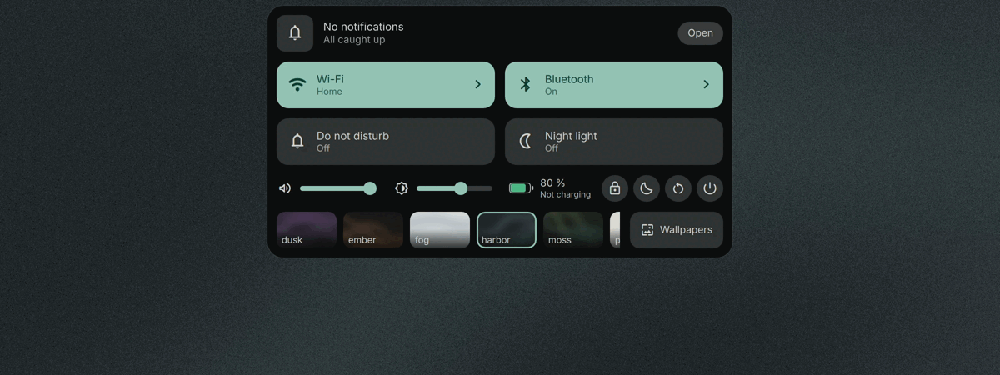
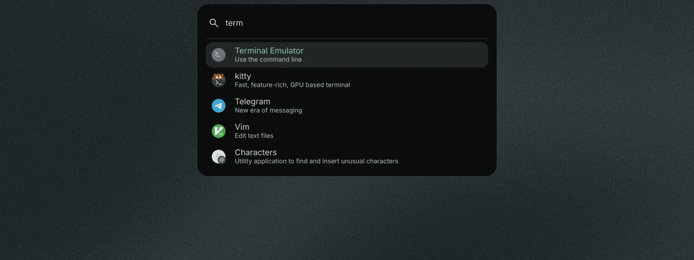
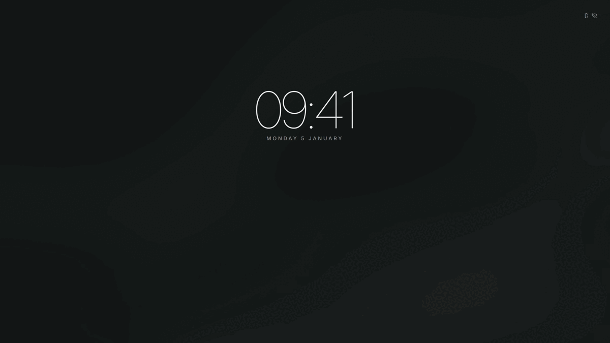

<div align="center">
  <picture>
    <source media="(prefers-color-scheme: dark)" srcset="assets/brand/social/readme-header-dark.svg" />
    <source media="(prefers-color-scheme: light)" srcset="assets/brand/social/readme-header-light.svg" />
    
  </picture>
  <p>Dynamic island shell for Hyprland, built on Quickshell.</p>
</div>

https://github.com/user-attachments/assets/c7b52b80-f737-4b0d-b1c2-1ea03514216e

Hush replaces the bar, launcher, notification daemon and control center with one pill at the
top of each monitor. The lock and login screens use the same island.

```bash
yay -S hush-git && /usr/share/hush/install.sh --no-fonts
```

Nix and manual install below.

<table>
  <tr><td><br/><sub>hover</sub></td><td><br/><sub>control center</sub></td></tr>
  <tr><td><br/><sub>launcher</sub></td><td><br/><sub>lock</sub></td></tr>
</table>


## Features

- **Island**: clock, activity circle and status ring at rest; files dragged onto the pill are kept for 24 h (a glyph at rest opens the shelf strip to drag them out, copy or remove); a hover face with workspaces, date
  and track; control center, media, calendar (with reminders: a time and a text, a notification when due, the next one on the pill), notification center, launcher (apps, windows,
  calculator, clipboard), wallpaper grid and settings open from the pill. The Wi-Fi page joins,
  forgets and details networks, joins hidden ones and runs a hotspot; a VPN tile toggles a
  NetworkManager VPN or WireGuard profile and an airplane mode tile (off by default) blocks every
  radio through rfkill. App status icons (StatusNotifierItem) sit behind a button in the control
  center's top row, never on the pill: the page lists them, a tap activates one, a right click lists
  its menu. The volume slider's end glyph opens the sound page: output devices (tap picks the
  default), the microphone and each playing application, with level and mute. OSDs and
  a Stay awake tile (off by default) holds an idle inhibitor. A command that ran 20 s or more in a
  terminal raises a result card when it ends (add `source ~/.config/hush/shell.sh` to your
  `~/.zshrc` or `~/.bashrc`; `HUSH_JOB_SECS` changes the threshold, a focused terminal stays quiet).
  notifications queue by priority; a removable drive raises a card with Mount, Open (xdg-open) and
  Eject (unmount, power off, then "Safe to remove") and a USB glyph sits on the rest pill while one is plugged in; needs udisks2. The battery chip opens the power-profile page when
  powerprofilesctl is installed. Modes `reserve`, `overlay`, `autohide`; fullscreen retract; keyboard navigation.
- **Live activities**: recording, countdown and now playing at rest; mic and camera in use. The
  timer tile's page runs a focus session (25 min focus, 5 min break, 15 min long break after the
  fourth block) with do not disturb on while it runs; the pill shows the ring and the block count.
- **Also**: one lock and login screen (Quickshell, SDDM, hyprlock fallback); optional GloView and
  dynamic-cursors plugins; a rEFInd boot menu; colours follow the wallpaper (matugen) across
  Hyprland, GTK, Qt, kitty and SDDM.

## Install

Requirements: Hyprland 0.56 or later (Lua config), Quickshell 0.3, matugen 4, awww,
python3 with Pillow, lua, imagemagick, git. Optional: sddm, fprintd (fingerprint unlock),
hyprlock (`hush lock --hyprlock`), hyprpm (plugins).

```bash
git clone https://github.com/sirrryasir/hush.git ~/hush
~/hush/install.sh          # --no-fonts / --no-theme skip those steps
```

Packaged: Arch `yay -S hush-git`, then `/usr/share/hush/install.sh --no-fonts`.
Nix `nix profile install github:sirrryasir/hush`, then `~/.nix-profile/share/hush/install.sh --no-fonts`.

`install.sh` symlinks the shell, matugen, hyprlock and `hush*` into `~/.config` and
`~/.local/bin`, installs fonts, enables the git hooks and sets the default colours (`harbor`). It never uses sudo
and never overwrites a real file: anything in the way moves to `~/.cache/hush/backup-<timestamp>/`.
Then autostart `hush reload` and `hush shell start` from `hyprland.lua`.

## Use

Hush ships no keybinds. Suggested ones, as `hl.bind(combo, hl.dsp.exec_cmd(cmd))`:

| Keys | Command |
| --- | --- |
| Super+Backspace | `qs -c hush ipc call hush toggleControlCenter` |
| Super+A | `qs -c hush ipc call hush toggleLauncher` |
| Super+V | `qs -c hush ipc call hush showLauncher clip` |
| Super+Shift+N | `qs -c hush ipc call hush toggleDrawer` |
| Super+Ctrl+W | `qs -c hush ipc call hush toggleWallpapers` |
| Super+Shift+W | `hush wall random` |
| Super+Tab | `hush overview` |

| Command | What it does |
| --- | --- |
| `hush shell <start\|stop\|restart\|status\|log>` | manage the shell |
| `hush lock [--hyprlock]` | lock the screen (Quickshell session lock; `--hyprlock` uses hyprlock) |
| `hush settings` | toggle the settings surface |
| `hush timer <N>m\|<N>s\|<N>h\|stop` | start or cancel a countdown in the island |
| `hush volume up\|down\|mute\|mic-mute [step]` | change volume (default 5 %) with the OSD |
| `hush brightness up\|down [step]` | change brightness (default 5 %) with the OSD |
| `hush reload` | re-render templates for the current state |
| `hush status` | print theme, wallpaper, mode and scheme |
| `hush check` | validate generated config (exit 1 on problems) |
| `hush generated` / `hush track <on\|off>` | list tracked generated files / mark them skip-worktree |
| `hush fallback` | stop Hush, start Waybar and SwayNC |
| `hush face <image>` | set the login avatar (`~/.face`, round crop) and refresh the SDDM theme |
| `hush sddm sync` | refresh the SDDM theme's wallpaper, colours and avatar |
| `hush plugins [status\|install]` | show or install the optional plugins |
| `hush overview` | toggle the GloView overview |
| `hush list` | list the themes |
| `hush theme <name\|next\|prev> [--from X,Y]` | apply a theme (wallpaper, colours, reloads) |
| `hush wall <path\|random> [--mode light\|dark] [--from X,Y]` | change the wallpaper, keep the theme's scheme |
| `hush --version` | print the version |

### Keyboard

In any island panel, Tab, Shift+Tab or the arrows move focus, Enter or Space activates, Esc closes.
Left and Right step a focused slider (Shift: ten steps); Shift+Up and Shift+Down move Settings rows.

## Configure

`hush settings` opens the settings surface; it writes `~/.config/hush/settings.json`, hot-reloaded
over `quickshell/hush/config/settings.default.json` and editable by hand.

**Hyprland.** Each monitor gets a transparent `hush-island` layer (full width, 360 px) whose input
mask follows the pill: `hl.layer_rule({ match = { namespace = "hush-island" }, blur = true, ignore_alpha = 0.2 })` blurs it.
`island.mode`: `reserve` (default; `island.reserve` px exclusive zone), `overlay` (none) or
`autohide` (a 1 px top strip reveals the pill on hover, workspace change and events); a fullscreen
window retracts it, and the top edge still reveals it.

**Interaction.** Hovering 120 ms opens the hover face; it closes 300 ms after the pointer leaves.
`island.clickLeft`, `clickRight`, `clickMiddle`: `cc`, `notifs`, `media`, `calendar`, `launcher`,
`none`. `island.scroll`: `volume`, `brightness`, `none`. `island.clock`: `24` or `12` (pill, lock,
login). Buttons ignore clicks for the first `motion.armMs` (500 ms); critical notifications stay
until clicked. Settings, Modules writes the `layout` key: which surfaces exist, the rest pill's
sides, the hover face chips and control center tiles (1x1 or 2x1); "Reset layout" removes it.
Over IPC, with a leading space: `qs -c hush ipc call hush settingsSet layout.hover ' [...]'`.

| Variable | Meaning |
| --- | --- |
| `HUSH_ROOT` | checkout with themes, templates and the shell (default: where `bin/hush` lives) |
| `XDG_CONFIG_HOME` | where generated files go (default `~/.config`) |
| `HUSH_WALL_DIRS` | colon-separated extra wallpaper folders |
| `HUSH_REDUCED_MOTION` | `1` makes theme and wallpaper changes instant |

**Generated files.** `hush generated` lists them; `hush track off` marks them skip-worktree when
`~/.config` is a git repo. The browser theme loads unpacked from `~/.config/hush/helium-theme`.

**Themes.** A new theme is a `themes/<name>/` folder with a `theme.toml` (copy one) and a
`wallpaper.png`; then `hush theme <name>`. `hush-wallgen <theme|all>` redraws the bundled ones.

**Plugins.** `hush plugins install` enables GloView and dynamic-cursors with hyprpm (needs the
Hyprland headers); then `pcall(dofile, os.getenv("HOME") .. "/.config/hush/plugins.lua")`.

**Lock and login.** One QML screen, `lockscreen/Screen.qml`, sized by `lockscreen/layout.toml`.
`hush lock` runs `quickshell/hush/lock.qml` as its own process, so a shell restart cannot unlock
it; the password goes through PAM `login`, and with fprintd a finger works in parallel
(`lockscreen/pam/fprint`). If the lock dies the session stays locked: from a TTY run
`hyprctl --instance 0 eval 'hl.clear_crashed_lockscreen()'`, then `hush lock`.
`hush lock --hyprlock` uses hyprlock with the layout `hush reload` writes to
`~/.config/hush/hyprlock-layout.conf`; it takes only the clock's weight and size and `lock.date`.
Settings, Lock (`lock.*`): `clock` `quiet` (default), `bold` (heavy) or `stacked` (hours over
minutes); `date`, `name`, `status` (`true`) show the date, the user name and the fingerprint /
wrong-password line; `reveal` (`true`) hides the pill until a key. Changes run `hush sddm sync`.

Login: `sudo ~/hush/sddm/install.sh` copies the greeter and its fonts to
`/usr/share/sddm/themes/hush`, writes `/etc/sddm.conf.d/hush.conf` and links the theme's `current`
to `~/.cache/hush/sddm`, which `hush sddm sync` (run by `hush theme` and `hush wall`) refreshes.
A `Current=` line in `/etc/sddm.conf` overrides it (the installer prints the fix), and `$HOME`
must be traversable by the `sddm` user (`chmod o+x ~`). `hush face <image>` sets the avatar.
With more than one account, the name over the pill opens the list of users.

**Boot menu.** `sudo ~/hush/integrations/refind/install.sh [theme]` copies a rEFInd theme to the
ESP and includes it from `refind.conf`; its banner is the theme's wallpaper (default: the current
one), so rerun it after `hush theme`. Remove the `include themes/hush/theme.conf` line to uninstall.

## Contributing

`bash tests/sandbox.sh` runs the suite in a nested Hyprland without touching your session;
`tests/test_<name>.sh` runs one.

## Credits

Built on [Quickshell](https://quickshell.org) and [matugen](https://github.com/InioX/matugen).
