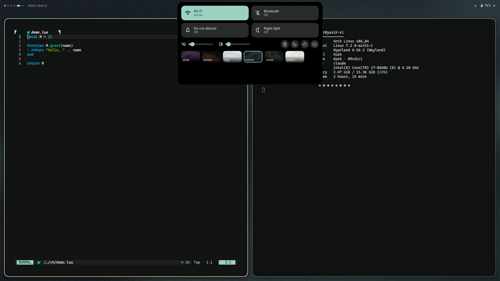

<div align="center">
  <picture>
    <source media="(prefers-color-scheme: dark)" srcset="assets/brand/social/readme-header-dark.svg" />
    <source media="(prefers-color-scheme: light)" srcset="assets/brand/social/readme-header-light.svg" />
    
  </picture>
  <p>A quiet, Apple-calm Hyprland desktop: one Quickshell shell, six themes, one command that recolors everything.</p>
  
</div>

## What it is

Hush is a quiet, Apple-calm desktop for Hyprland (0.55+, Lua config) on Arch. A single Quickshell shell provides the dynamic island (clock, media, OSD, notifications, control center), screen corners, launcher, wallpaper grid and notification drawer. `hush theme <name>` picks a wallpaper, runs matugen and re-renders colors for the shell, Hyprland, kitty, Neovim, GTK, Qt, Kvantum, hyprlock, fastfetch and the browser theme in one pass.

<table>
  <tr>
    <td><br/><sub>dusk</sub></td>
    <td><br/><sub>ember</sub></td>
    <td><br/><sub>fog</sub></td>
  </tr>
  <tr>
    <td><br/><sub>harbor</sub></td>
    <td><br/><sub>moss</sub></td>
    <td><br/><sub>paper</sub></td>
  </tr>
</table>

Control center per theme: [dusk](assets/themes/dusk-cc.png), [ember](assets/themes/ember-cc.png), [fog](assets/themes/fog-cc.png), [harbor](assets/themes/harbor-cc.png), [moss](assets/themes/moss-cc.png), [paper](assets/themes/paper-cc.png).

## What's inside

- `quickshell/hush/`: the shell (island, corners, launcher, wallpaper grid, drawer, notification daemon)
- `bin/hush`: the CLI; `bin/hush-wallgen`, `bin/hush-fonts`, `bin/hush-gtk`: helpers
- `matugen/`: templates and per-target config fragments that render the theme
- `themes/`: one folder per theme (`theme.toml` plus a generated wallpaper)
- `hyprlock/`: lock screen config and layout (colors are generated)
- `integrations/nvim/`: a LazyVim plugin spec that follows the generated colorscheme
- `tests/`: `bash tests/run_all.sh` (live tests drive the running shell and Hyprland)

## Commands

| Command | What it does |
| --- | --- |
| `hush theme <name\|next\|prev>` | apply a theme (wallpaper, colors, reloads) |
| `hush wall <path\|random>` | change the wallpaper, keep the theme's scheme |
| `hush reload` | re-render templates for the current state |
| `hush status` | print active theme, wallpaper, mode, scheme |
| `hush check` | validate generated config (exit 1 on problems) |
| `hush fallback` | stop the Hush shell, start Waybar and SwayNC |
| `hush shell <start\|stop\|restart\|status\|log>` | manage the Quickshell shell |
| `hush generated` / `hush track <on\|off>` | list generated files that a git repo tracks / mark them skip-worktree there |
| `hush --version` | print the version |

## Add a theme

1. Create `themes/<name>/` with a `theme.toml` (copy an existing one) and a wallpaper.
2. Run `hush-wallgen` to generate its wallpapers.
3. `hush theme <name>`.

## Keybinds

Hush ships no keybinds; bind the IPC calls and commands in your Hyprland config, for example:

```lua
hl.bind("SUPER + Backspace", hl.dsp.exec_cmd("qs -c hush ipc call hush toggleControlCenter"))
hl.bind("SUPER + A",         hl.dsp.exec_cmd("qs -c hush ipc call hush toggleLauncher"))
hl.bind("SUPER + SHIFT + N", hl.dsp.exec_cmd("qs -c hush ipc call hush toggleDrawer"))
hl.bind("SUPER + CTRL + W",  hl.dsp.exec_cmd("qs -c hush ipc call hush toggleWallpapers"))
hl.bind("SUPER + V",         hl.dsp.exec_cmd("qs -c hush ipc call hush showLauncher clip"))
hl.bind("SUPER + ALT + right", hl.dsp.exec_cmd("~/.local/bin/hush theme next"))
hl.bind("SUPER + SHIFT + W", hl.dsp.exec_cmd("~/.local/bin/hush wall random"))
```

and start it from autostart: `hush reload` then `hush shell start`.

The island is one transparent, full-width layer per monitor (namespace `hush-island`, 360 px tall, never resized); only its input mask follows the pill, so clicks beside the pill reach your windows. Blur it with a layer rule; `ignore_alpha` keeps the transparent area unblurred:

```lua
hl.layer_rule({ match = { namespace = "hush-island" }, blur = true, ignore_alpha = 0.2 })
```

`island.mode` in `~/.config/hush/settings.json` picks `reserve` (default, `island.reserve` = 40 px exclusive zone), `overlay` (no reserve) or `autohide` (a 1 px strip at the top edge, `hush-island-reveal`, shows the pill on hover, on workspace change and for OSDs, notifications and the control center). A fullscreen window retracts the pill.

## Installation

Needs Hyprland, Quickshell (`qs`), matugen, python3 with Pillow, lua, awww (wallpapers), imagemagick and git.

```bash
git clone https://github.com/sirrryasir/hush.git ~/hush
~/hush/install.sh          # --no-fonts / --no-theme to skip those steps
```

`install.sh` symlinks `~/.config/quickshell/hush`, `~/.config/matugen`, `~/.config/hyprlock`, `~/.config/hypr/hyprlock.conf`, `~/.local/bin/hush*` and (for LazyVim) `~/.config/nvim/lua/plugins/hush-theme.lua` into the checkout, installs the fonts into `~/.local/share/fonts/hush`, enables the git hooks and applies `harbor` on first run. It is idempotent and never overwrites a real file: anything in the way is moved to `~/.cache/hush/backup-<timestamp>/`.

## Configuration

| Setting | Default | Meaning |
| --- | --- | --- |
| `HUSH_ROOT` | the checkout that `bin/hush` lives in | where themes, templates and the shell are read from |
| `XDG_CONFIG_HOME` | `~/.config` | where generated files are written |
| `HUSH_WALL_DIRS` | unset | colon-separated extra wallpaper folders for `hush wall random` and the wallpaper grid |

Generated files (`hush generated`) land in `~/.config`: Hyprland `hypr/modules/theme.lua` and `gloview-colors.lua`, kitty `theme.conf`, `nvim/colors/hush.lua`, GTK, qt6ct, Kvantum, fastfetch, waybar, hyprlock and `~/.config/hush/` (Colors.json, p10k colors, browser theme). If `~/.config` is itself a dotfiles repo, `hush track off` marks the tracked ones `skip-worktree` so `git commit -a` leaves them alone. The fastfetch template reads its logo from `~/.config/fastfetch/logo.txt`.

## Contributing

Conventional Commits, one coherent change per commit, tests green first; see [docs/COMMITS.md](docs/COMMITS.md). `install.sh` enables the `pre-commit` (personal-data scan and `hush check`) and `commit-msg` hooks.

## Credits

[Quickshell](https://quickshell.org), [matugen](https://github.com/InioX/matugen), and the caelestia and Tide-island shells as references.
