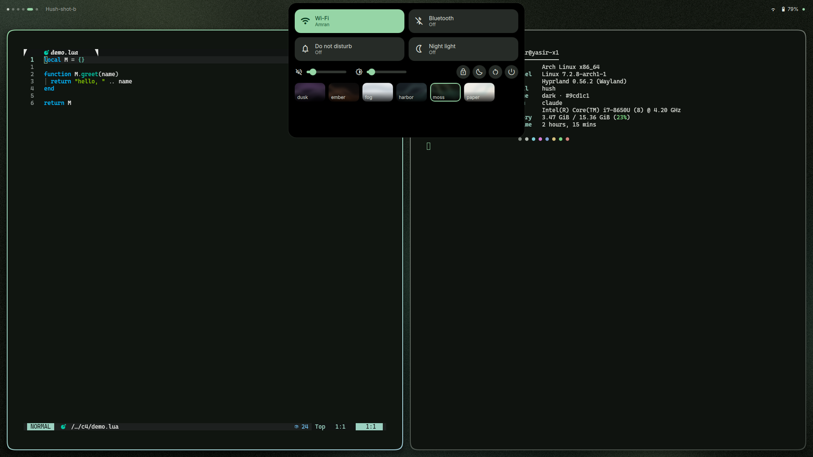

<div align="center">
  <picture>
    <source media="(prefers-color-scheme: dark)" srcset="assets/brand/social/readme-header-dark.svg" />
    <source media="(prefers-color-scheme: light)" srcset="assets/brand/social/readme-header-light.svg" />
    
  </picture>
  <p>Dynamic island shell for Hyprland, built on Quickshell.</p>
</div>


Hush replaces the bar, launcher, notification daemon and control center with one pill at the
top of each monitor. Six themes recolour the shell and the applications it templates; the
lock and login screens use the same island. Full-quality demo: [hush-demo.mp4](assets/demo/hush-demo.mp4).

<table>
  <tr><td><br/><sub>dusk</sub></td><td><br/><sub>ember</sub></td><td><br/><sub>fog</sub></td></tr>
  <tr><td><br/><sub>harbor</sub></td><td><br/><sub>moss</sub></td><td><br/><sub>paper</sub></td></tr>
</table>

At rest: [dusk](assets/themes/dusk.png), [ember](assets/themes/ember.png), [fog](assets/themes/fog.png), [harbor](assets/themes/harbor.png), [moss](assets/themes/moss.png), [paper](assets/themes/paper.png).

## Features

- **Island**: clock, activity circle and status ring at rest; a hover face with workspaces, date
  and track; control center, media, calendar, notification center, launcher (apps, windows,
  calculator, clipboard), wallpaper grid and settings open from the pill. OSDs and notifications
  queue by priority. Modes `reserve`, `overlay`, `autohide`; fullscreen retract; keyboard navigation.
- **Live activities**: recording, countdown and now playing at rest; mic and camera in use.
- **Theming**: `hush theme` recolours the shell, Hyprland, kitty, Neovim, GTK, Qt/Kvantum,
  hyprlock, SDDM, fastfetch and the browser, with a circle-reveal wallpaper transition.
- **Lock and login**: one QML screen for the session lock and the SDDM greeter; hyprlock fallback.
- **Optional**: GloView overview and dynamic-cursors plugins, a matching rEFInd boot menu.

## Install

Requirements: Hyprland 0.56 or later (Lua config), Quickshell 0.3, matugen 4, awww,
python3 with Pillow, lua, imagemagick, git. Optional: sddm, fprintd (fingerprint unlock),
hyprlock (`hush lock --hyprlock`), hyprpm (plugins).

```bash
git clone https://github.com/sirrryasir/hush.git ~/hush
~/hush/install.sh          # --no-fonts / --no-theme skip those steps
sudo ~/hush/sddm/install.sh   # optional login screen; needs root
sudo ~/hush/integrations/refind/install.sh   # optional boot menu; needs root
```

`install.sh` symlinks the shell, matugen, hyprlock and `hush*` into `~/.config` and
`~/.local/bin`, installs fonts, enables the git hooks and applies `harbor`. It never uses sudo
and never overwrites a real file: anything in the way moves to `~/.cache/hush/backup-<timestamp>/`.
Then autostart `hush reload` and `hush shell start` from `hyprland.lua`.

## Use

Hush ships no keybinds. Suggested ones, as `hl.bind(combo, hl.dsp.exec_cmd(cmd))`:

| Keys | Command |
| --- | --- |
| Super+Backspace | `qs -c hush ipc call hush toggleControlCenter` |
| Super+A | `qs -c hush ipc call hush toggleLauncher` |
| Super+V | `qs -c hush ipc call hush showLauncher clip` |
| Super+Shift+N | `qs -c hush ipc call hush toggleDrawer` |
| Super+Ctrl+W | `qs -c hush ipc call hush toggleWallpapers` |
| Super+Alt+Right | `hush theme next` |
| Super+Shift+W | `hush wall random` |
| Super+Tab | `hush overview` |

| Command | What it does |
| --- | --- |
| `hush list` | list the themes |
| `hush theme <name\|next\|prev> [--from X,Y]` | apply a theme (wallpaper, colours, reloads) |
| `hush wall <path\|random> [--mode light\|dark] [--from X,Y]` | change the wallpaper, keep the theme's scheme |
| `hush reload` | re-render templates for the current state |
| `hush status` | print theme, wallpaper, mode and scheme |
| `hush check` | validate generated config (exit 1 on problems) |
| `hush generated` / `hush track <on\|off>` | list tracked generated files / mark them skip-worktree |
| `hush shell <start\|stop\|restart\|status\|log>` | manage the shell |
| `hush fallback` | stop Hush, start Waybar and SwayNC |
| `hush settings` | toggle the settings surface |
| `hush lock [--hyprlock]` | lock the screen (Quickshell session lock; `--hyprlock` uses hyprlock) |
| `hush face <image>` | set the login avatar (`~/.face`, round crop) and refresh the SDDM theme |
| `hush sddm sync` | refresh the SDDM theme's wallpaper, colours and avatar |
| `hush plugins [status\|install]` | show or install the optional plugins |
| `hush overview` | toggle the GloView overview |
| `hush timer <N>m\|<N>s\|<N>h\|stop` | start or cancel a countdown in the island |
| `hush volume up\|down\|mute\|mic-mute [step]` | change volume (default 5 %) with the OSD |
| `hush brightness up\|down [step]` | change brightness (default 5 %) with the OSD |
| `hush --version` | print the version |

### Keyboard

In any island panel, Tab, Shift+Tab or the arrows move focus, Enter or Space activates, Esc closes.
Left and Right step a focused slider (Shift: ten steps); Shift+Up and Shift+Down move Settings rows.

## Configure

`hush settings` opens the settings surface; it writes `~/.config/hush/settings.json`, which
also works by hand and is hot-reloaded. Every key, the blur rule, lock and login, plugins and the
boot menu: [docs/configuration.md](docs/configuration.md).

New theme: a `themes/<name>/` folder with a `theme.toml` (copy one) and a `wallpaper.png`, then
`hush theme <name>`. `hush-wallgen <theme|all>` regenerates the bundled wallpapers.

## Contributing

- Tests: `bash tests/sandbox.sh` runs the suite in a nested Hyprland without touching your
  session; `bash tests/run_all.sh` drives the live shell; `tests/test_<name>.sh` runs one.
- Conventional Commits, subject at most 72 characters, a body that says why. The hooks check the
  format, scan for personal data (no user names, home paths or monitor names) and run `hush check`.
- Releases: `chore(release): X.Y.Z` bumps `VERSION` and `CHANGELOG.md`, then an annotated tag.

## Credits

Built on [Quickshell](https://quickshell.org) and [matugen](https://github.com/InioX/matugen).
The caelestia, Tide-island, end-4 and saneAspect configurations were studied as references.
