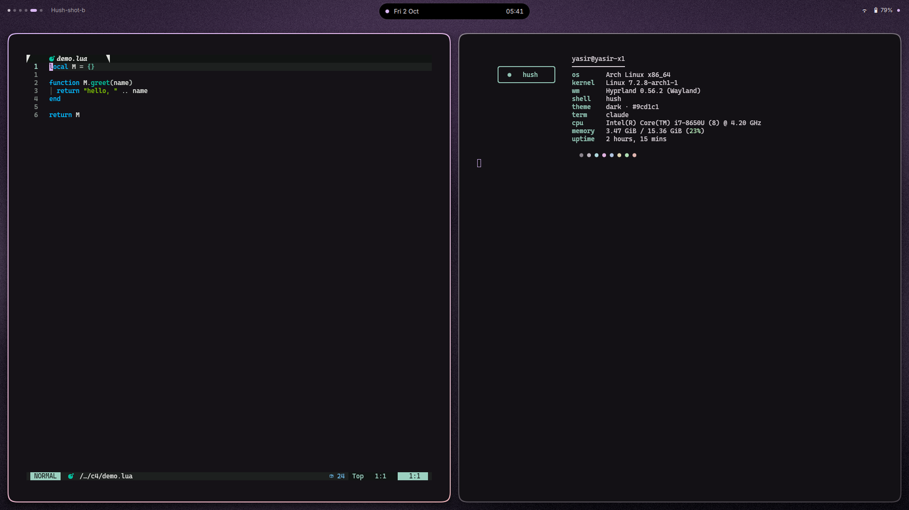
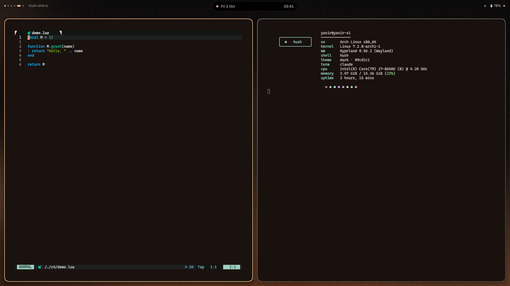
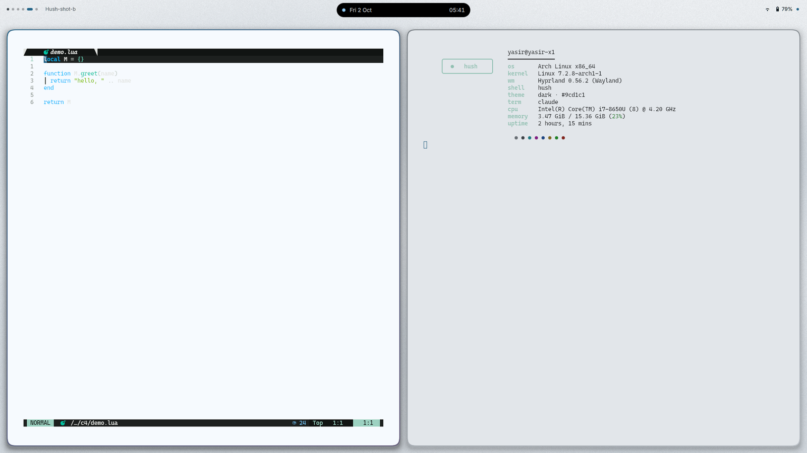
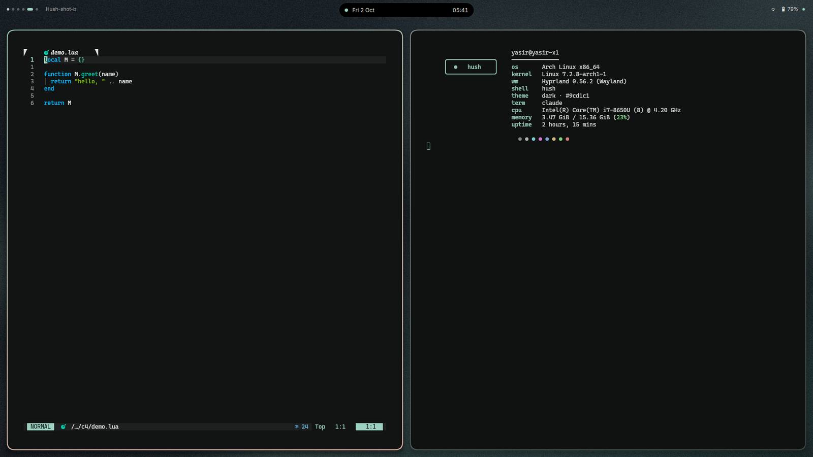
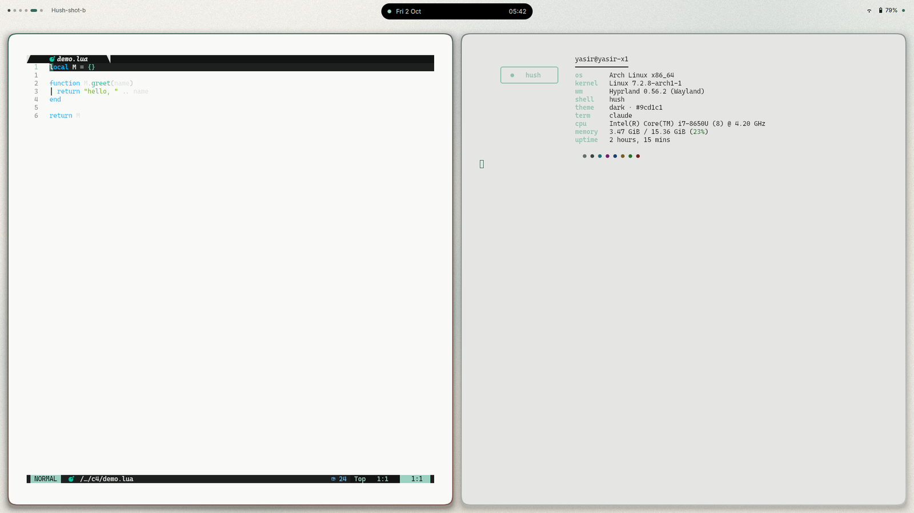

<div align="center">
  <picture>
    <source media="(prefers-color-scheme: dark)" srcset="assets/brand/social/readme-header-dark.svg" />
    <source media="(prefers-color-scheme: light)" srcset="assets/brand/social/readme-header-light.svg" />
    
  </picture>
  <p>A quiet Hyprland shell: one black island that everything grows out of.</p>
</div>


Full-quality recording: [assets/demo/hush-demo.mp4](assets/demo/hush-demo.mp4)

Hush is a Quickshell desktop shell for Hyprland. One pill at the top of each monitor is the
clock, OSD, notifications, control center, launcher, wallpaper grid and settings. `hush theme`
recolours the shell and every app it templates in one pass; lock and login use the same island.

<table>
  <tr>
    <td><br/><sub>dusk</sub></td>
    <td><br/><sub>ember</sub></td>
    <td><br/><sub>fog</sub></td>
  </tr>
  <tr>
    <td><br/><sub>harbor</sub></td>
    <td><br/><sub>moss</sub></td>
    <td><br/><sub>paper</sub></td>
  </tr>
</table>

Control center per theme: [dusk](assets/themes/dusk-cc.png), [ember](assets/themes/ember-cc.png), [fog](assets/themes/fog-cc.png), [harbor](assets/themes/harbor-cc.png), [moss](assets/themes/moss-cc.png), [paper](assets/themes/paper-cc.png).

## Features

- **Island**: a narrow pill at rest (clock, activity circle, status ring); hover face with workspaces, date and track; configurable left, right and middle click and scroll; control center, media, calendar, notification center, launcher (apps, windows, calculator, clipboard), wallpaper grid and settings grow out of the pill; a priority arbiter with a resuming queue for OSDs and notifications; `reserve`, `overlay` and `autohide` modes; fullscreen retract and reveal; full keyboard navigation.
- **Theming**: six themes; `hush theme` recolours the shell, Hyprland, kitty, Neovim, GTK, Qt/Kvantum, hyprlock, SDDM, fastfetch and the browser; circle-reveal wallpaper transition from the island; shell colours cross-fade; WCAG contrast gates in the tests.
- **Lock and login**: island-native hyprlock and SDDM greeter from one layout spec; `hush face` sets the avatar.
- **Settings**: a settings surface with live preview, a composer for the rest pill, hover face and control center, all stored in `~/.config/hush/settings.json`.
- **Plugins** (optional): GloView overview and dynamic-cursors (shake to find), coloured from the theme.
- **Live activities**: recording, countdown timer and now playing shown at rest; mic and camera use in the status ring.

## Install

Requirements: Hyprland 0.56 or later (Lua config), Quickshell 0.3, matugen 4, awww, hyprlock,
python3 with Pillow, lua, imagemagick, git. Optional: sddm, hyprpm (plugins).

```bash
git clone https://github.com/sirrryasir/hush.git ~/hush
~/hush/install.sh          # --no-fonts / --no-theme skip those steps
sudo ~/hush/sddm/install.sh   # optional login screen; the only step that needs root
```

`install.sh` symlinks the shell, matugen, hyprlock and `hush*` into `~/.config` and
`~/.local/bin`, installs fonts, enables the git hooks and applies `harbor`. It never uses sudo
and never overwrites a real file: anything in the way moves to `~/.cache/hush/backup-<timestamp>/`.
Autostart `hush reload` then `hush shell start`. Blur rule, modes and links: [docs/configuration.md](docs/configuration.md).

## Use

Hush ships no keybinds. Suggested binds (`hl.bind(combo, hl.dsp.exec_cmd(cmd))` in `hyprland.lua`):

| Keys | Command |
| --- | --- |
| Super+Backspace | `qs -c hush ipc call hush toggleControlCenter` |
| Super+A | `qs -c hush ipc call hush toggleLauncher` |
| Super+V | `qs -c hush ipc call hush showLauncher clip` |
| Super+Shift+N | `qs -c hush ipc call hush toggleDrawer` |
| Super+Ctrl+W | `qs -c hush ipc call hush toggleWallpapers` |
| Super+Alt+Right | `hush theme next` |
| Super+Shift+W | `hush wall random` |
| Super+Tab | `hush overview` |

| Command | What it does |
| --- | --- |
| `hush list` | list the themes |
| `hush theme <name\|next\|prev> [--from X,Y]` | apply a theme (wallpaper, colours, reloads) |
| `hush wall <path\|random> [--mode light\|dark] [--from X,Y]` | change the wallpaper, keep the theme's scheme |
| `hush reload` | re-render templates for the current state |
| `hush status` | print theme, wallpaper, mode and scheme |
| `hush check` | validate generated config (exit 1 on problems) |
| `hush generated` / `hush track <on\|off>` | list tracked generated files / mark them skip-worktree |
| `hush shell <start\|stop\|restart\|status\|log>` | manage the shell |
| `hush fallback` | stop Hush, start Waybar and SwayNC |
| `hush settings` | toggle the settings surface |
| `hush lock` | lock the screen with hyprlock |
| `hush face <image>` | set the lock and login avatar |
| `hush sddm sync` | refresh the SDDM theme's wallpaper, colours and avatar |
| `hush plugins [status\|install]` | show or install the optional plugins |
| `hush overview` | toggle the GloView overview |
| `hush timer <N>m\|<N>s\|<N>h\|stop` | start or cancel a countdown in the island |
| `hush volume up\|down\|mute\|mic-mute [step]` | change volume (default 5 %) with the OSD |
| `hush brightness up\|down [step]` | change brightness (default 5 %) with the OSD |
| `hush --version` | print the version |

### Keyboard

In any island panel, Tab and Shift+Tab or the arrows move focus, Enter or Space activates, Esc closes.
Left and Right step a focused slider; hold Shift for steps of ten.
Settings rows move with Shift+Up and Shift+Down.

## Configure

Settings live in `~/.config/hush/settings.json` (defaults: `quickshell/hush/config/settings.default.json`),
hot-reloaded. `hush settings` opens the GUI; Settings, Modules composes the rest pill, hover face and
control center. Keys, modes, click mapping, environment: [docs/configuration.md](docs/configuration.md).

Add a theme:

1. Create `themes/<name>/theme.toml` (copy an existing one).
2. Run `hush-wallgen` to generate its wallpaper.
3. Run `hush theme <name>`.

Plugins: `hush plugins install`, then load `~/.config/hush/plugins.lua` from `hyprland.lua` ([docs/configuration.md](docs/configuration.md#plugins)).

## Contributing

- Tests: `bash tests/sandbox.sh` runs the suite in a nested Hyprland without touching your
  session; `bash tests/run_all.sh` drives the live shell; `tests/test_<name>.sh` runs one.
- Conventional Commits, 72-character subject, one coherent change per commit with a body that
  says why. The hooks `install.sh` enables check the format, scan for personal data and run
  `hush check`. No user names, home paths or monitor names in the tree.
- Releases at milestones: `chore(release): X.Y.Z` bumps `VERSION` and `CHANGELOG.md`, then an
  annotated tag.

## Credits

Built on [Quickshell](https://quickshell.org) and [matugen](https://github.com/InioX/matugen).
The caelestia, Tide-island, end-4 and saneAspect configurations were studied as references.
