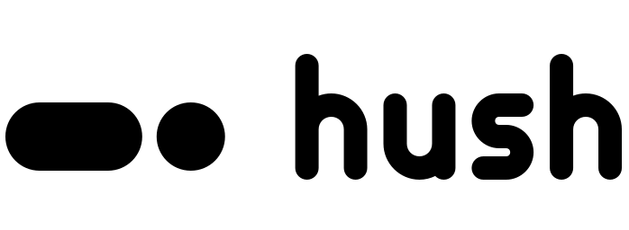

# Brand

One mark, one wordmark, one stroke. `python3 assets/brand/src/build.py` (needs `inkscape` and
`rsvg-convert`) draws them and writes every file below; it is the source of truth for the geometry.

**The mark, Breath**: the island pill (2 : 1, fully round ends) and one dot of the same height, a
gap of 16 on a 256 grid apart. The white cut is 2 units thinner so it does not look heavier on
black. **The wordmark**: `hush`, lowercase, drawn from the same round-ended stroke, never set in a
font. Black on light, white on dark; the theme accent is optional.

| Use | File (under `assets/brand/`) |
| --- | --- |
| Symbol and horizontal lockup | `svg/hush-{symbol,lockup}-{black,white}.svg` |
| App icon (squircle, mark at 60 %) | `app/hush-app-icon-{dark,light}.svg`, `-512.png` |
| Favicon | `web/favicon.svg`, `web/favicon.ico` |
| README header | `social/readme-header-{dark,light}.svg` |
| GitHub social preview | `social/social-preview-dark.png` |
| Default lock and login face | `social/avatar-256.png` (also `sddm/hush/assets/avatar.png`) |
| fastfetch logo | `matugen/templates/fastfetch-logo.svg`, tinted with the theme primary by `hush theme` |

Clear space is the dot's diameter; the symbol is not used below 16 px. Don't recolour the pill and
the dot separately, add effects, change the gap or the 2 : 1 pill, or add a `$`, chevron or cursor:
Hush is not a command shell.
